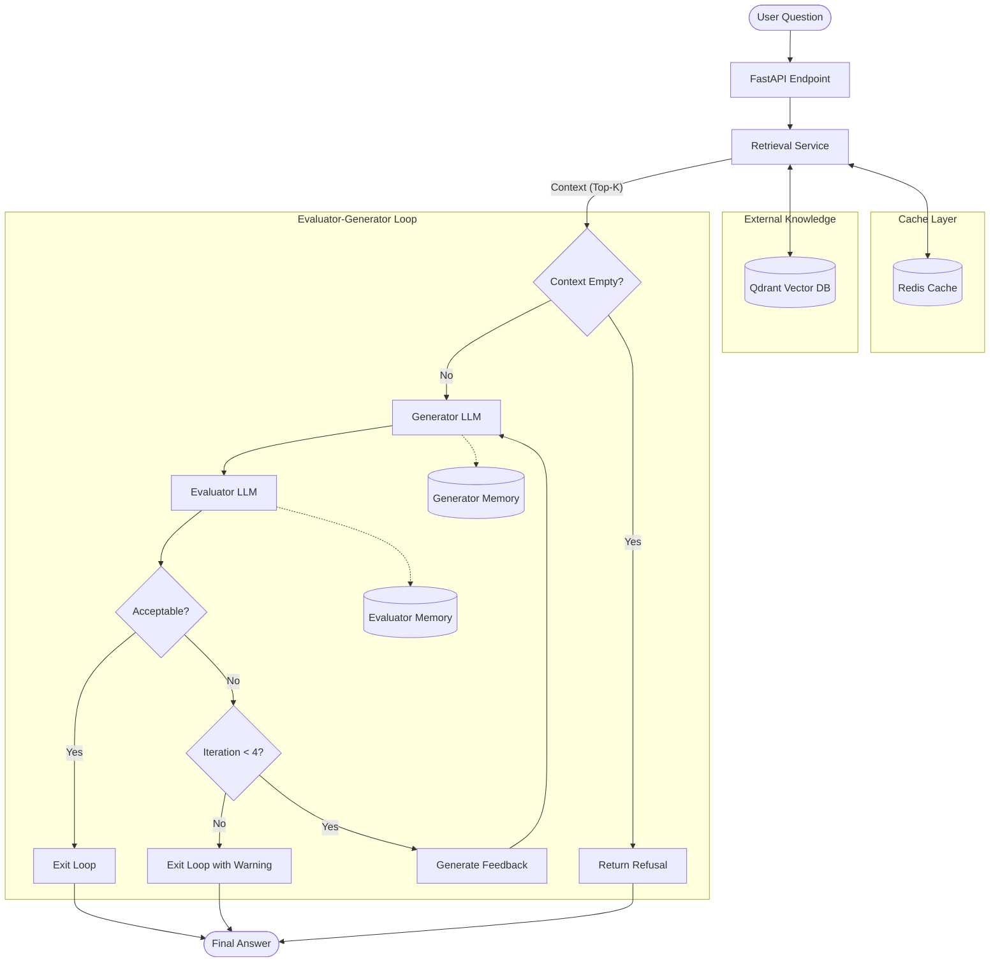

# LLM Evaluator-Generator Platform

A self-evaluating Question-Answering platform built with **FastAPI, LangChain, and LCEL**. It features an iterative Generator ↔ Evaluator feedback loop, isolated agent memories, and a Redis caching layer to provide highly grounded, reliable answers over external knowledge sources.

## 🏗️ Architecture & Workflow

The system features two specialized LLM agents:

1. **Generator:** Retrieves context and drafts an answer. It strictly refuses to answer if the context is missing.
2. **Evaluator:** Scores the answer based on accuracy, relevance, completeness, and grounding. If the answer is unsatisfactory, it provides feedback to the Generator for another attempt.

The evaluation loop is capped at **4 iterations** to prevent infinite execution and excessive API costs. If the maximum number of iterations is reached, the system returns the latest answer with a `Not Validated` warning.

### Workflow Diagram



## 📂 Supported Knowledge Formats

The ingestion pipeline supports:

- **Documents:** PDF, DOCX, TXT, and PPTX.
- **Source Code:** Any programming language, with AST-aware chunking.
- **Web:** Standard URLs and Wikipedia pages.
- **Audio:** WAV files transcribed using `faster-whisper`.

## ⚙️ Tech Stack

| Component | Technology |
|---|---|
| Backend | FastAPI, Uvicorn |
| Orchestration | LangChain, LCEL, Python State Machine |
| LLM Provider | Groq |
| LLM Models | Llama 3.3 70B / GPT-OSS |
| Vector Database | Qdrant |
| Caching | Redis |
| Frontend | Jinja2, HTMX |
| Audio Transcription | faster-whisper |
| Containerization | Docker Compose |

## 🚀 Quickstart

### 1. Prerequisites

Ensure the following are installed:

- Python 3.10+
- Docker Desktop
- Git

**Intel Mac compatibility:** If you are using an Intel-based Mac, `numpy<2` and `torch==2.2.2` are pinned in `pyproject.toml` to help ensure compatibility.

### 2. Clone the Repository

```bash
git clone <repository-url>
cd <project-directory>
```

Replace `<repository-url>` and `<project-directory>` with your repository URL and project directory name.

### 3. Configure Environment Variables

Create your environment file:

```bash
cp .env.example .env
```

Edit `.env` and configure your Groq API key and model settings:

```env
LLM_PROVIDER=groq
GROQ_API_KEY=gsk_...
GENERATOR_MODEL=openai/gpt-oss-120b
EVALUATOR_MODEL=openai/gpt-oss-20b
```

Replace `gsk_...` with your actual Groq API key. Never commit your `.env` file or expose your API key publicly.

### 4. Start Infrastructure Services

Start Redis and Qdrant using Docker Compose:

```bash
docker compose up -d redis qdrant
```

### 5. Set Up the Python Environment

Create and activate a virtual environment:

```bash
python -m venv .venv
source .venv/bin/activate
```

Install the project and development dependencies:

```bash
pip install -e ".[dev]"
```

### 6. Run the Application

Start the FastAPI development server:

```bash
uvicorn app.main:app --reload
```

### 7. Access the UI

Open the ingestion interface in your browser:

[http://127.0.0.1:8000/ui/ingest](http://127.0.0.1:8000/ui/ingest)

From the interface, you can:

- **Ingest Knowledge:** Upload supported files or ingest content from URLs.
- **Ask Questions:** Query the indexed knowledge base.
- **Inspect Evaluations:** Use the Loop Inspector to examine evaluation scores, feedback, and iterations.
- **Review Answers:** See the final answer and determine whether it passed evaluation.

## 🧠 Design Decisions

### 1. Generator-Evaluator Feedback Loop

The platform separates answer generation from answer evaluation.

- The Generator retrieves and uses relevant context to produce a grounded answer.
- The Evaluator independently assesses the answer and identifies issues.
- Evaluation feedback is passed back to the Generator to improve subsequent attempts.
- The loop is limited to four iterations to control execution time and API costs.
- If the answer is not accepted within the iteration limit, the latest answer is returned with a warning that it has not been validated.

### 2. Isolated Agent Memories

`GeneratorMemory` and `EvaluatorMemory` are implemented as independent classes.

Each agent maintains its own memory, namespaced by `session_id`. This ensures that their states remain isolated and that the Generator's working memory is not directly shared with the Evaluator.

### 3. Redis Caching

Redis provides a caching layer to reduce redundant computation and improve response times.

The caching system supports:

- **Embedding Cache:** Caches embeddings using text hashes to avoid repeatedly embedding identical text.
- **Retrieval Cache:** Caches retrieval results to avoid unnecessary vector database queries.
- **Cache Invalidation:** Invalidates affected cached data when knowledge sources are added or deleted.

### 4. Graceful Refusal

Grounded answers are a core design principle.

If the vector database returns no relevant context, the system immediately returns a refusal response without calling the LLM. This prevents unsupported answers and avoids unnecessary API costs.

### 5. Bounded Execution

The evaluation loop has a strict maximum of four iterations. This prevents infinite loops and limits token consumption, execution time, and API expenses.

If the maximum iteration count is reached without acceptance, the system returns the latest answer with a validation warning.

## 🔒 Reliability and Grounding

The platform is designed to improve answer reliability through:

- Context-grounded generation.
- Explicit refusal when relevant context is unavailable.
- Independent answer evaluation.
- Iterative feedback and answer refinement.
- A bounded evaluation loop.
- Session-specific agent memories.
- Caching and invalidation strategies for retrieval efficiency.

**Important:** Evaluation improves answer quality but does not guarantee factual correctness. An answer is considered validated only when it satisfies the configured evaluation criteria.

## 📌 Future Improvements

Potential areas for further development include:

- Adding structured evaluation outputs with explicit scoring thresholds.
- Improving retrieval quality through reranking and metadata filtering.
- Tracking evaluation metrics across multiple questions and sessions.
- Adding automated tests for retrieval, caching, and evaluation-loop behavior.
- Supporting additional LLM providers.
- Improving observability with structured logs and execution traces.
- Adding more ingestion formats and advanced code-aware chunking strategies.

## 📄 License

Add your preferred license here, such as MIT, if applicable.
